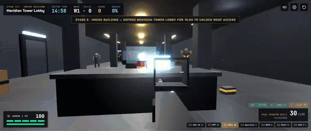
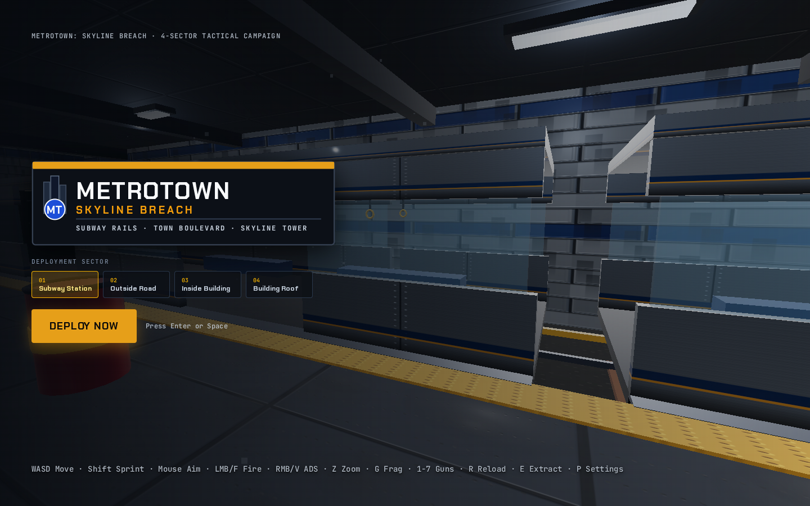
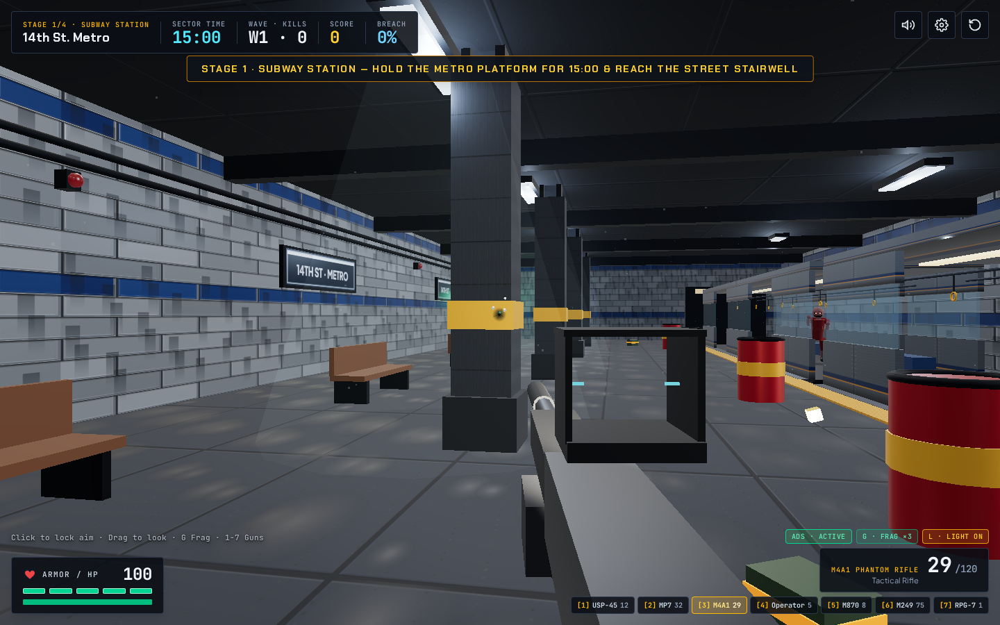
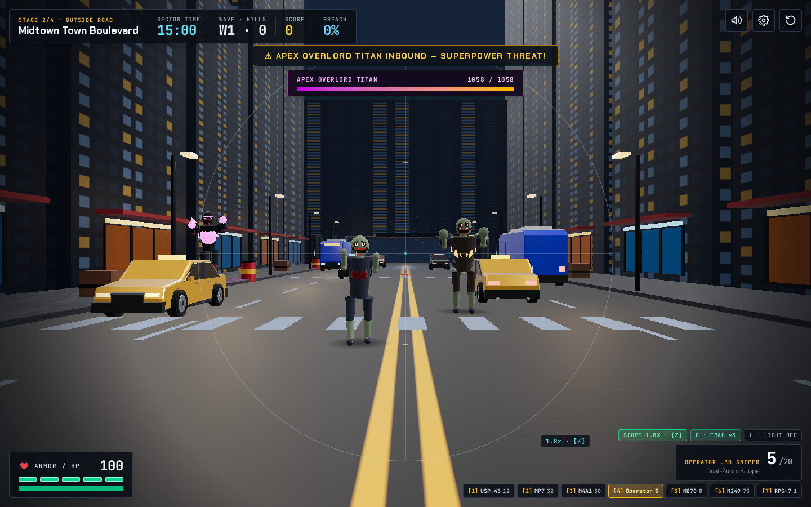
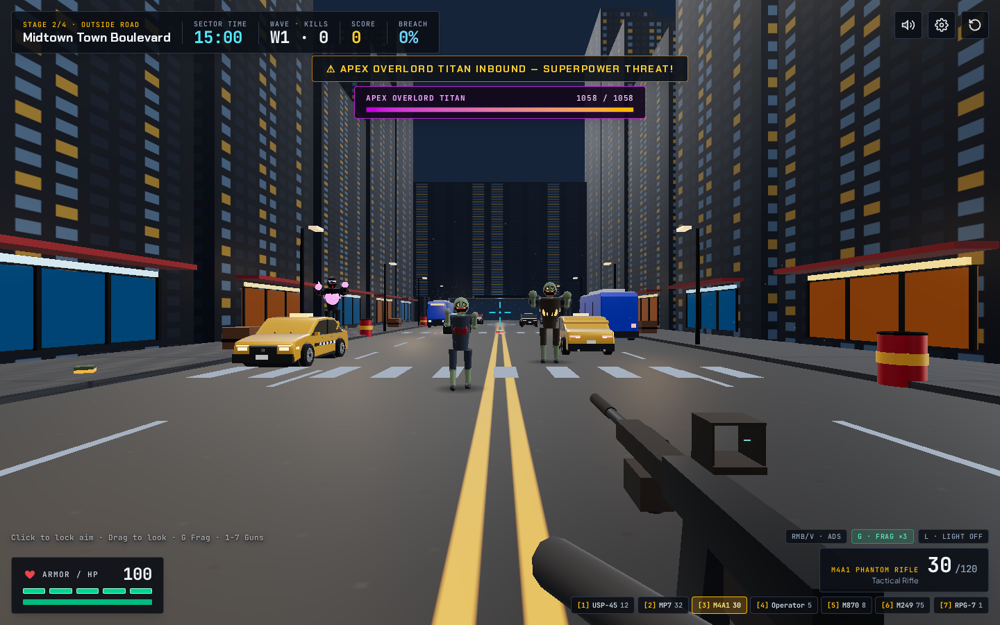
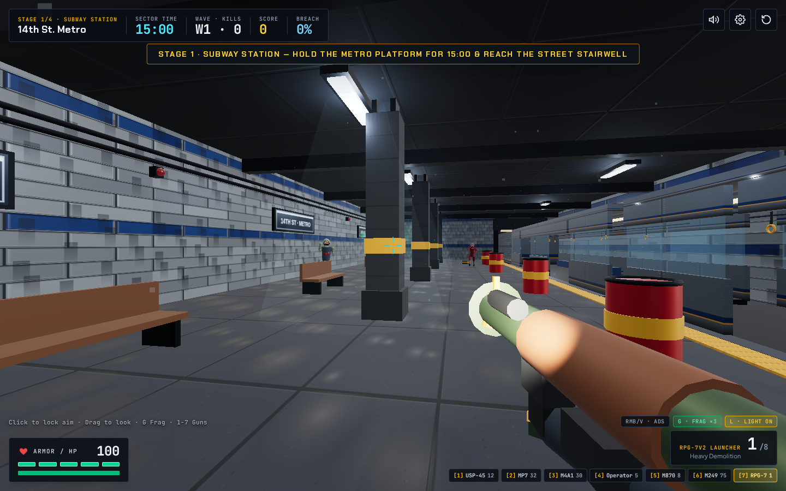
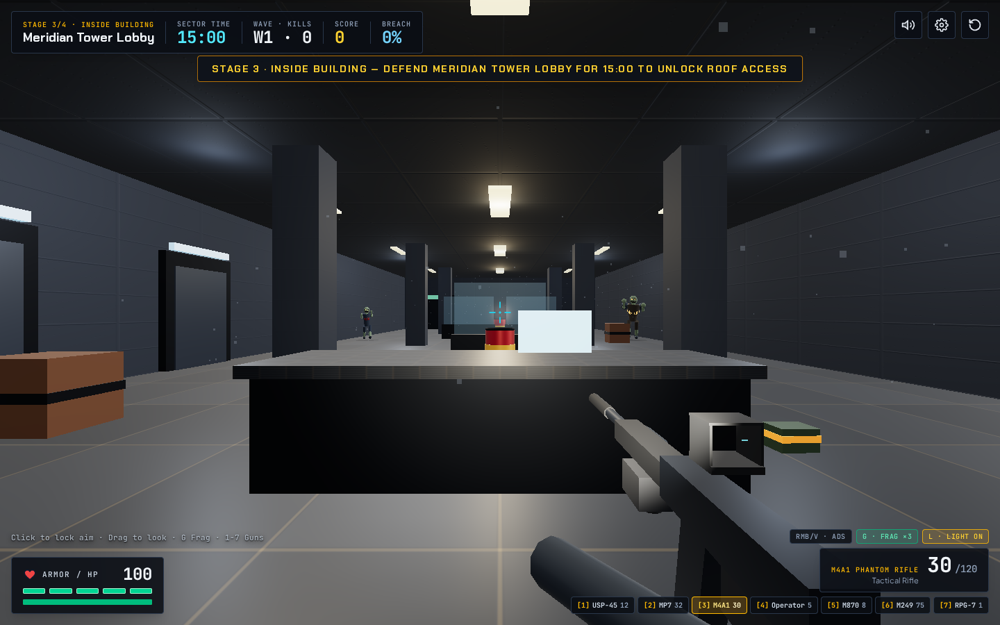
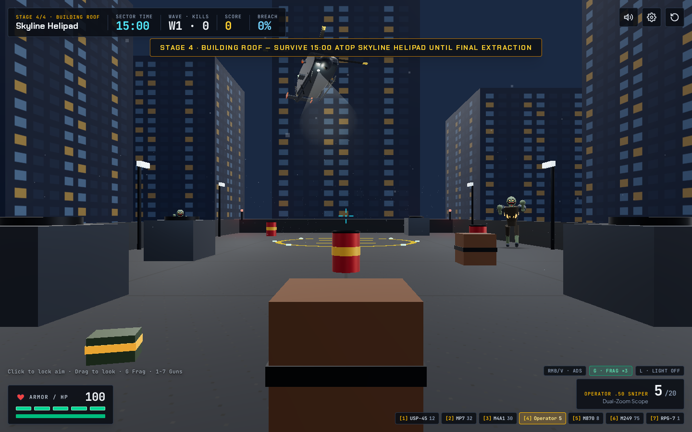
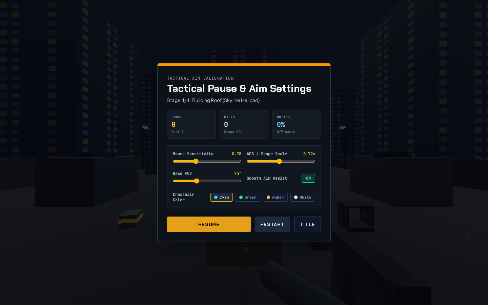

# MetroTown: Skyline Breach

**Subway Rails · Town Boulevard · Meridian Tower · Skyline Helipad**

**Created by Md Shabbir Mia**

`MetroTown: Skyline Breach` is a 3D tactical first-person survival shooter built by **Md Shabbir Mia** with **Three.js**, **React**, **TypeScript**, **Tailwind CSS**, and procedural **Web Audio**. Survive **15-minute escalating holds (`15:00`)** in each of four fully lit architectural sectors—from the **14th St. Metro** underground platform, out onto the wide **Midtown Town Boulevard**, inside the **Meridian Tower Lobby**, and up to the **Skyline Helipad**—against creepy grinning infected waves and recurring **Apex Overlord Titan** superpower bosses.

---

## Gameplay Video Showcase (`readme_videos/`)

Watch live gameplay across **14th St. Metro** (moving subway train & Apex Overlord Titan), **Midtown Town Boulevard** (realistic curved non-blocking traffic), and **Meridian Tower Lobby** (glassless ADS combat & RPG demolition). The highlight reel below plays automatically—click it (or the link underneath) to play the full **3:06 gameplay video with audio (`7.9 MB` MP4)**:

[](readme_videos/metrotown-skyline-breach-gameplay.mp4)

> **[▶ Watch Full Gameplay Video with Audio (`metrotown-skyline-breach-gameplay.mp4` · 7.9 MB)](readme_videos/metrotown-skyline-breach-gameplay.mp4)**

---

## Visual Walkthrough & Features (`readme_images/`)

### 1. Title Screen & 4-Sector Deployment
Live 3D camera tour across whichever deployment sector you pick (`01 Subway Station`, `02 Outside Road`, `03 Inside Building`, or `04 Building Roof`) before dropping directly into combat.



### 2. Crystal-Clear ADS Optics & Target-Only Hit Feedback
Open holographic sights use glassless transparent apertures with minimal edge ticks—no opaque blue tint, oversized center blobs, or blinding muzzle-flash glare when firing while aimed. Hitmarkers (`TARGET HIT`, `HEADSHOT`, `CORE CRIT`, `TARGET ELIMINATED`, `APEX TITAN DEFEATED`) display strictly when shots connect with enemies.



### 3. Scary Smiling Infected Horde
Every infected unit—**Shamblers**, **Sprinters**, armored **Brutes**, ranged **Spitters**, and the **Apex Overlord Titan**—wears a wide, sinister carved grin with upturned crimson cheek slashes, **9 upper and 7 lower jagged glowing ivory fangs**, deep hollow eye sockets, glowing irises, and vertical **black slit pupils**.



### 4. Expanded Midtown Town Boulevard, Realistic Non-Blocking 4-Lane Traffic & Superpowered Titan Boss
Stage 2 opens onto a full **78m × 18m 4-lane town avenue** framed by **5.6m raised sidewalks**, crosswalks, illuminated storefronts, streetlamps on both curbs, and East/West overpass underpass tunnels. **8 active moving vehicles** (detailed yellow taxis, police cruisers with gold badges and red/blue lightbars, curved sports sedans, and city transit buses featuring recessed wheel wells, 5-spoke alloy wheels, wraparound tinted glass, B/C pillars, chrome trim, multi-element LED headlights/DRLs, and license plates) cruise smoothly down both lanes—**passing harmlessly without hitting, blocking, or harming either the player or infected enemies** while remaining fully shootable and destructible. Periodically throughout every 15-minute hold, the towering **Apex Overlord Titan** enters with a dedicated boss health bar and three superpowered attacks.



### 5. Moving Subway Train, Swinging Handles & RPG-7V2 Demolition
In Stage 1 (`14th St. Metro`), a **2-car subway train** continuously rolls along the 148m rails through open East/West tunnel portals—slowing smoothly as it enters the station platform, accelerating through the tunnels with spinning bogie wheelsets, headlights/taillights, inertial swinging grab handles, and full ride-along deck physics. Fire the **RPG-7V2 Launcher (`[7]`)** or toss **Frag Grenades (`[G]`)** to blow open destructible train hull panels, pillars, benches, and fuel barrels.



### 6. Inside Building — Meridian Tower Lobby
Stage 3 moves indoors into the bright **Meridian Tower Lobby**, complete with an illuminated **security reception desk**, a **3-door elevator bank**, marble tile floors, destructible glass partitions, overhead luminaire grids, and the roof-access exit beacon.



### 7. Building Roof — Twin-Turbine Rescue Helicopter Landing & Dual-Zoom Sniper Scope
Stage 4 concludes high atop the **Skyline Helipad** surrounded by a 360° illuminated skyscraper ring, twin North/South floodlight towers, destructible HVAC units, and the rooftop stairwell penthouse. A detailed **Twin-Turbine Tactical Rescue Helicopter**—complete with curved extruded fuselage, sloped glass canopy and illuminated avionics console, twin turboshaft engines, rescue orange livery, hoist winch arm, tubular landing skids, FLIR turret, gimballed searchlight cone, pulsing tail beacon, and spinning 4-blade main and tail rotors—performs a smooth S-curve skyline approach, nose-up landing flare, and precision touchdown directly onto the lit green-LED **Skyline Helipad**. Aim with the **Operator .50 Sniper (`[4]`)** and press **`[Z]`** (or Middle Click / Mouse Wheel) while scoped to switch between **1.8× (`38°` FOV)** and **3.2× (`22°` FOV)** transparent scopes.



### 8. Tactical Aim Calibration & Pause Settings
Press **`[P]`** anytime to open **Tactical Pause & Aim Settings** featuring focal-length-matched **ADS / Scope Scale**, **Mouse Sensitivity**, **Base FOV (`65°–95°`)**, **Smooth Aim Assist**, and **Crosshair Color** (`Cyan`, `Green`, `Amber`, `White`).



---

## Key Gameplay Systems

### 15-Minute Per-Scenario Hold & 4-Stage Campaign
Each sector enforces a full **15:00 (`900` seconds)** tactical hold with escalating enemy waves (`Wave 1`, `Wave 2`, … every 60 seconds) and **no premature skips** or dark unlit dead voids:

| Stage | Sector | Arena Title | Hold Duration | Architecture & Destructibles |
| :---: | :--- | :--- | :---: | :--- |
| **1 / 4** | Subway Station | **14th St. Metro** | **15:00** | Open tunnel portals, **moving 2-car destructible train** with ride-along deck & spinning wheels, swinging inertial grab handles, tiled pillars, benches, fuel barrels, street stairwell exit |
| **2 / 4** | Outside Road | **Midtown Town Boulevard** | **15:00** | Wide **78m × 18m** 4-lane avenue + **5.6m** sidewalks, crosswalks, East/West underpass portals, storefronts, streetlamps, **8 moving curved destructible taxis, police cruisers, sedans & transit buses** (non-blocking traffic) |
| **3 / 4** | Inside Building | **Meridian Tower Lobby** | **15:00** | Bright corporate lobby, security reception desk, 3-door elevator bank, destructible glass partitions, steel columns, roof-access stairwell |
| **4 / 4** | Building Roof | **Skyline Helipad** | **15:00** | Helipad **`H`** zone with glowing perimeter LEDs, **animated landing Twin-Turbine Rescue Helicopter**, stairwell penthouse, North & South floodlights, 10-tower 360° lit skyline ring, destructible HVAC units |

- When the **Sector Time** countdown reaches `00:00` (`EXIT READY` in green), the **Extraction Zone** beacon activates—step inside or press **`[E]`** nearby to advance to the next scenario (Stages 1–3), or complete Stage 4's final stand for victory.

---

## 7-Weapon Arsenal & Frag Grenades
All 7 weapons include custom 3D viewmodels, material-aware bullet hole decals, procedural Web Audio SFX, and FOV-matched sensitivity scaling:

| Slot | Weapon | Role | Damage | Mag / Start Reserve | Fire Mode | Key Features |
| :---: | :--- | :--- | :---: | :---: | :---: | :--- |
| **`1`** | **USP-45 Tactical** | Precision Sidearm | 34 | 12 / 72 | Semi-Auto | Fast `1.0s` reload, tight hip/ADS spread |
| **`2`** | **MP7 Vector SMG** | Rapid CQB | 21 | 32 / 160 | Full-Auto | High fire rate, open glassless holosight |
| **`3`** | **M4A1 Phantom Rifle** | Tactical Rifle | 30 | 30 / 120 | Full-Auto | Versatile mid-range suppressed carbine |
| **`4`** | **Operator .50 Sniper** | Dual-Zoom Scope | 145 | 5 / 20 | Bolt / Semi | **`Z`** toggles **1.8× (`38°`)** / **3.2× (`22°`)** clear scope |
| **`5`** | **M870 Breacher** | Close Spread | 20 × 7 pellets | 8 / 32 | Pump-Action | Animated pump rack, 7-pellet close burst |
| **`6`** | **M249 Heavy LMG** | Squad Suppression | 26 | 75 / 150 | Full-Auto | Deep 75-round belt for endless wave control |
| **`7`** | **RPG-7V2 Launcher** | Heavy Demolition | 280 (`255` splash) | 1 / 8 | Rocket | `6.4m` explosion shatters train cars, vehicles & walls |
| **`G`** | **Frag Grenade** | Tactical Ordnance | `230` splash | 3 carried (max 5) | Thrown Arc | `1.85s` bounce fuse, `6.2m` blast radius, refills at ammo crates |

---

## Scary Infected Roster & Apex Overlord Titan Superpowers
- **Apex Overlord Titan (`titan`)**: First arrives around `40s` into a sector and returns every **`180s`** (`3:00`) throughout the 15-minute hold (`920` base HP × stage multiplier, glowing magenta armor visor, and **`1.55×` Critical Chest Core**). Alternates three telegraphed superpowers:
  1. **Seismic Slam**: Telegraphed ground pound unleashing an expanding `8.8m` shockwave ring that rattles hanging handles and hits grounded players within `8.4m` (`Space` to jump over).
  2. **Void Plasma**: Launches a 3-orb spreading magenta plasma volley.
  3. **Hyper Surge**: High-speed (`12.5 m/s`) armored rush across the arena.
- **Standard Scary-Smiling Infected**:
  - **Shambler**: Persistent melee infected with bloodied torso and serrated toothy grin.
  - **Sprinter**: Fast lateral-weaving rusher.
  - **Brute**: Heavy glowing-fissure juggernaut (`260` base HP) with windup slams.
  - **Spitter**: Mid-range attacker firing acid projectiles.

---

## Controls

| Action | Input |
| :--- | :--- |
| **Move / Strafe** | `W` `A` `S` `D` or `Arrow Up/Down` |
| **Look / Turn Camera** | `Mouse` (click canvas for Pointer Lock, or click-drag anytime) / `Arrow Left/Right` |
| **Sprint / Jump** | `Shift` (sprint) · `Space` (jump over Seismic Slam shockwaves) |
| **Fire Weapon** | `Left Click` (`LMB`) or `F` |
| **Aim Down Sights (ADS)** | Hold `Right Click` (`RMB`) or toggle `V` |
| **Sniper Scope Tier (1.8× / 3.2×)** | `Z`, `Middle Click`, or `Mouse Wheel` while scoped with `[4]` |
| **Switch Weapons** | `1` – `7`, `Q` (cycle), or `Mouse Wheel` |
| **Throw Frag Grenade** | `G` |
| **Reload** | `R` |
| **Tactical Flashlight** | `L` |
| **Advance to Next Sector** | Reach green **Extraction Zone** or press `E` once `EXIT READY` (`00:00`) |
| **Pause & Aim Calibration** | `P` / `Esc` / `Tab` |
| **Mute / Unmute Audio** | `M` |

---

## Development & Verification

### Install & Run
```bash
npm install
npm run dev
```
The Express + Vite development server listens on `http://localhost:3000`.

### Unit Tests, Type-Check & Build
Core game rules, 15-minute stage timers, wave progression, Titan interval triggers, moving train/vehicle physics, helicopter landing state progression, ADS/FOV sensitivity scaling, destructible collider resolution, and pendulum physics live in `src/game/rules.ts` with automated coverage in `src/game/rules.test.ts`:

```bash
# Run deterministic unit tests (15/15 passing)
npx --yes tsx --test src/game/rules.test.ts

# TypeScript type-check & production Vite bundle
npm run lint
npm run build
```

### Project Architecture
- `src/game/rules.ts` — Pure game rules, `STAGE_DURATION_SECONDS = 900`, `WEAPON_SPECS`, `ROUND_CONFIGS`, `stepMovingTrain`, `stepMovingVehicle`, `stepHelicopterLanding`, `shouldUnlockSectorExit`, `computeStageWave`, `shouldSpawnTimedBoss`, ballistics/spread/FOV math, collision resolution, and pendulum physics.
- `src/game/rules.test.ts` — `node:test` unit suite (`15` tests).
- `src/game/models.ts` — Procedural PBR textures, all 4 brightly lit architectural stage builders, moving train & realistic curved boulevard vehicle rigs, Twin-Turbine Rescue Helicopter rig on Stage 4 helipad, scary slit-pupil grinning zombie & Titan boss rigs, destructible props, and glassless open-holo weapon viewmodels.
- `src/game/SubwayGameEngine.ts` — Three.js renderer loop, FPS controller, moving train & non-blocking traffic simulation, helicopter approach/flare/landing animation, continuous wave & Titan superpower AI, RPG/grenade physics, bullet decals, and throttled HUD snapshots.
- `src/game/audio.ts` — Procedural Web Audio synthesizer for weapons, reloads, footsteps, pickups, material hits, and boss abilities.
- `src/components/` — `TitleOverlay.tsx`, `GameHud.tsx`, and `ModalOverlay.tsx`.
- `readme_images/` — Verified gameplay & UI screenshots (`01` through `08`).
- `readme_videos/` — Auto-playing highlight preview (`metrotown-gameplay-preview.gif`, 6.3 MB) and compact full gameplay video (`metrotown-skyline-breach-gameplay.mp4`, 7.9 MB).

---

## Author
**Md Shabbir Mia**
